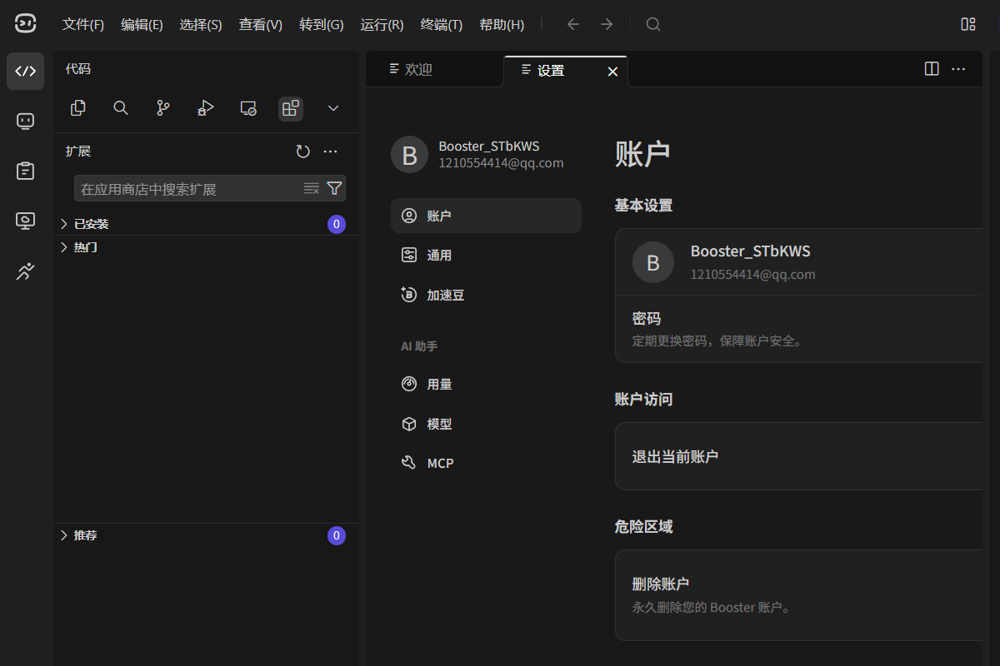

# 01 · 环境准备

> **目标**：把「能在 Booster K1 上安装、调试 Agent」的开发环境准备好。
> **官方章节**：[Agent 开发概述](https://docs.booster.tech/zh-CN/docs/developer-guide/agent-development/intro/) ・ [快速上手](https://docs.booster.tech/zh-CN/docs/developer-guide/agent-development/quick-start/)

---

## 0. 你需要什么

| 项 | 说明 |
| --- | --- |
| 电脑 | Windows / Linux / macOS 均可 |
| 机器人 | Booster K1（教育版 / 专业版 / 极客版） |
| 手柄 | Booster 手柄或 XBOX 手柄（用于快捷键操作） |
| 手机 | 安装 Booster App **1.7 及以上** |
| 网络 | 电脑、手机与机器人**在同一局域网** |

---

## 1. 安装并登录 Booster Studio

1. 打开 <https://studio.booster.tech/cn/> 下载对应系统的 Booster Studio
2. 安装后启动，使用 Booster 账号登录（首次登录会进入「账户」页，确认昵称与邮箱无误）



> Booster Studio 内置了完整的开发、运行与调试环境，并附带标准 Agent 项目模板，**不需要自己从零搭环境**。

---

## 2. 确认固件版本

这是最容易踩坑的一步，先确认再动手：

- 安装 Python Agent 要求 **固件 ≥ 1.7.0**，低于这个版本**安装会失败**
- 查看方式：[K1 产品手册 → 固件版本 → 查看版本](https://docs.booster.tech/zh-CN/docs/product-manual/k1/firmware-version/check-version/)

```
固件 < 1.7.0  →  无法安装 Python Agent，先升级固件
固件 = 1.7.0  →  可以安装，但系统未预置 boosteros，需要手动 pip 安装
固件 ≥ 1.8.0  →  可以安装，boosteros 已预置，开箱即用
```

---

## 3. 固件版本与 API Level 的关系

Agent 的能力边界由 **API Level** 描述，它和固件版本一一对应：

```
API Level = 主版本 × 10000 + 次版本 × 100 + 修订版本
```

| 固件版本 | API Level |
| --- | --- |
| 1.7.0 | 10700 |
| 1.8.1 | 10801 |
| 1.13.0 | 11300 |

| API Level | 对应 Booster Studio 版本 |
| --- | --- |
| `10700` | < 1.13.0 |
| `10800` | ≥ 1.13.0 |

**注意**：`agent.toml` 里的 `requirements.min_api_level` 要填**兼容的最低** API Level。如果你用了更高版本的接口，必须在代码里用 `get_sys_api_level()` 做兼容判断，否则在老固件上会直接报错。

---

## 4. 连接机器人

### 4.1 连接真机

在 Booster Studio 中连接机器人（电脑与机器人需在同一网段）。连接成功后即可在 Studio 里运行、调试 Agent。

### 4.2 使用虚拟机器人（没有真机也能开发）

Booster Studio 提供虚拟机器人，适合先跑通界面和逻辑：

| 平台名 | 对应环境 |
| --- | --- |
| `sim_x86_64` | Booster Studio x86 虚拟机器人（Windows / Linux） |
| `sim_aarch64` | Booster Studio ARM 虚拟机器人（macOS） |

---

## 5. 目标平台名称对照

`build.toml` 中的 `platform.supports` 使用下面这些名字：

| 平台名 | 对应环境 |
| --- | --- |
| `sim_x86_64` | Booster Studio x86 虚拟机器人（Windows / Linux） |
| `sim_aarch64` | Booster Studio ARM 虚拟机器人（macOS） |
| `real_jetson` | Booster T1、**Booster K1 教育版 / 专业版**、Booster T2 |
| `real_qcom` | **Booster K1 极客版** |

> ⚠️ K1 极客版 与 教育版/专业版 走的是**不同平台**（`real_qcom` vs `real_jetson`）。打包时如果只勾了一个，另一种机器上会装不上或跑不起来。

---

## 6. 仅固件 1.7.0 需要做：安装 `boosteros`

1.7.0 固件**没有内置** `boosteros` 库。而 K1 上的 Agent 基本都会通过 `BoosterRobot` 调用机器人能力，例如：

```python
from boosteros.robots.booster import BoosterRobot
```

**缺少这个库时，Agent 启动会直接失败**（典型报错：`No module named 'boosteros'`）。

解决办法：SSH 登录机器人，执行

```bash
pip install boosteros
```

- **固件 ≥ 1.8.0 无需此步**，系统已预置
- SSH 的地址、账号与登录方式见官方 [连接机器人](https://docs.booster.tech/zh-CN/docs/product-manual/k1/basic-operations/connect-robot/) 文档

---

## 7. 环境自检清单

动手装 Agent 之前，逐条打勾：

- [ ] Booster Studio 已安装并登录成功
- [ ] 能连接到真机，**或**能启动虚拟机器人
- [ ] 机器人固件版本 **≥ 1.7.0**（已记录具体版本号）
- [ ] 若固件是 1.7.0，已 SSH 登录并完成 `pip install boosteros`
- [ ] 手机 Booster App 已安装（1.7+）并能连上机器人
- [ ] 手柄可正常连接（需要用到快捷键时）

全部通过后，进入 **[02-install-agent.md](02-install-agent.md)**。
